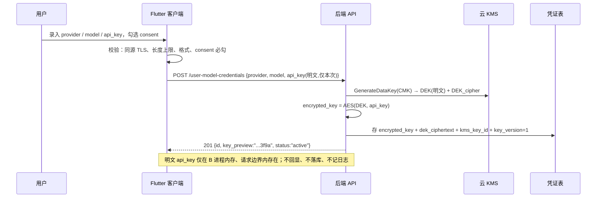
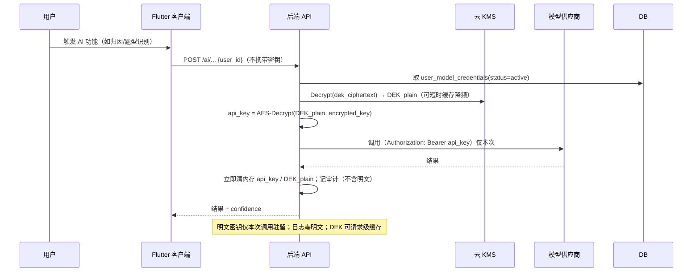
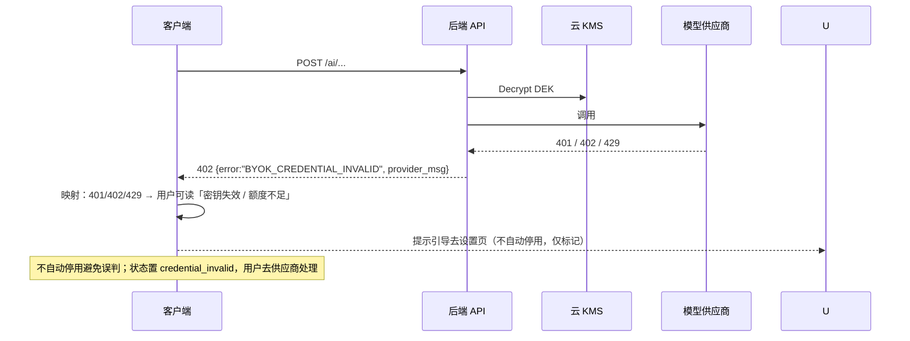
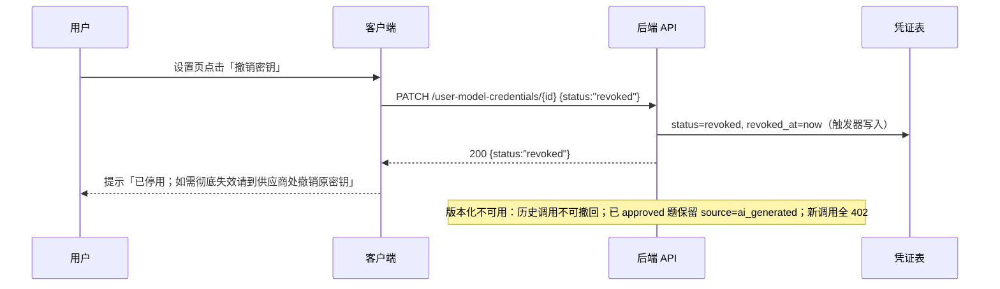
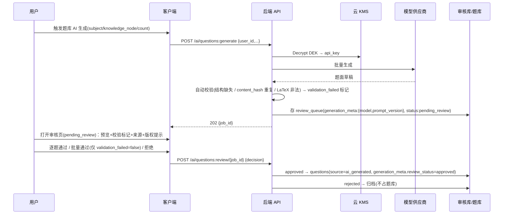
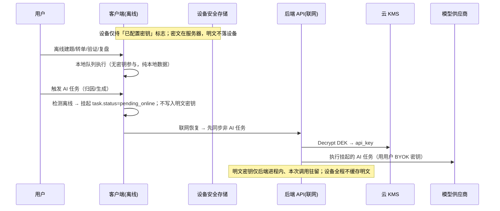

# 题路 TillRoad · BYOK 密钥生命周期决策文档

> 版本: v1.2 | 配套: `题路TillRoad-开发文档初稿.md`（第 4/7/9/15 节）、`schema.sql` v0.3-schema1、`mvp-tasks.md` v0.3
> v1.2 修订（评审后）：审核七态 UI 编号由 FE-02 更正为 FE-11（原 FE-02=建题/导入页）；补「凭证 revoked 时立即清除该用户 DEK 缓存」；补场景 1 `base_url` 责任边界（URL 格式/SSRF 由应用层执行，DB 不兜底）；详见 `REVIEW-NOTES.md`。
> 目的: 把 **15.3-②（KMS 选型）** 与 **15.3-③（AI 生成题审核 UI 形态）** 合并到**同一条密钥生命周期**下决策。
> 结论: 本文件在 BE-00 建表前修正 4 项硬伤（补 provider/model 字段、加轮换 deprecated、加熔断 cooldown、锁死 provider 枚举），评审通过即关闭 15.3-②③，后续 BE-00 / FE-11 / FE-09 / BE-08 不再返工。（审核七态 UI 为 FE-11，动效见 `fe-11-audit-motion-spec.md`）

---

## 1. 一句话决策

> **平台从「AI 成本承担者」变为「AI 能力赋能者 + 安全边界守护者」：**
> 用户自带密钥（BYOK），平台**不托管明文、不代付、不越权**；AI 功能全部走用户密钥，未配置时核心闭环仍可纯手动跑通。
> 两条遗留（KMS 选型、审核 UI 形态）被同一条密钥生命周期约束——**密钥怎么存、何时解密、失效怎么兜底、生成任务如何携带凭证**——因此一张生命周期图即可同时关闭二者。

---

## 2. 核心约束（一条生命周期约束两项决策）

```
[配置] 用户填密钥 ──TLS──▶ 后端信封加密入库（明文不落库/不回显/不记日志）
   │
   ▼
[调用] 后端取密文 ──▶ KMS 解 DEK ──▶ 解用户密钥 ──▶ 仅本次调用驻留 ──▶ 调用完即清内存
   │
   ▼
[失效] 401/402/429 ──▶ 映射为用户可读状态 ──▶ 引导去设置页（不自动停用）
   │
   ▼
[撤销] status=revoked + revoked_at ──▶ 新调用全 402 ──▶ 提示用户去供应商侧彻底撤销
   │
   ▼
[生成] 用户触发 ──▶ 生成→自动校验→pending_review→用户确认→入库(source=ai_generated)
   │
   ▼
[离线] AI 任务不持明文 ──▶ 离线挂起 ──▶ 联网后由后端用用户密钥执行
```

- **KMS 选型 = “哪个环节交给谁托管”**：配置/调用/撤销/审计四个环节，谁负责解密、谁保留证据。
- **审核 UI 形态 = “密钥失效 / 调用失败时界面展示什么状态”**：场景 3/5 的失败态直接驱动 `credential_invalid`、`validation_failed`、`pending_review` 三个界面状态。

---

## 3. 六个场景时序图

> 参与者缩写：U=用户，C=Flutter 客户端，MS=设备安全存储(Keychain/Keystore)，B=后端 API，K=云 KMS，AI=模型供应商，DB=题库/审核库，TQ=任务队列。

### 场景 1 · 首次配置密钥（关闭 15.3-②：写入边界）



**决策落点**：写入边界 = 同源 HTTPS + 显式 consent + 长度上限；明文**绝不回显、不落库、不记日志**；`key_preview` 仅存末 4 位。**`provider` 枚举 MVP 锁死 `deepseek` / `openai_compatible` 两类**（薄 adapter，不承诺支持任意 API）；`openai_compatible` 必填 `base_url`，`deepseek` 可空（用默认端点）。`base_url` 须做 SSRF 校验：仅允许 HTTPS 协议；**拒绝**私有 IP 段（RFC1918 / 链路本地 / 回环）、`localhost`、云元数据地址（如 `169.254.169.254`）；DNS 解析后**二次校验**解析出的 IP 归属（防止 DNS rebinding 绕过）；调用超时 ≤ 10s。**责任边界**：`schema.sql` 仅用 `chk_umc_baseurl` 校验「`openai_compatible` 时 `base_url` 非空」，**URL 协议/格式核验与 SSRF 拦截由应用层 `base_url` 校验函数执行**（不在 DB 兜底），实现者不得假设 DB 已做 SSRF 防护。

**责任边界强化（本轮 A3 · 实现者必读）**：`schema.sql` 对 `base_url` 仅有 `chk_umc_baseurl` 一个 CHECK（`openai_compatible` 时非空），**不含**任何 URL 协议 / 格式 / 主机归属 / SSRF 校验约束；**URL 格式与 SSRF 校验一律由应用层执行，DB 不兜底**。分层参考：`core/index.mjs` 的 `validateAIGenerateRequest()`（HTTPS + 私有 IP / 回环 / 云元数据地址拦截）负责安全校验，数据库只负责「非空」。实现者不得因看到 `chk_umc_baseurl` 就误以为数据库已做 URL / SSRF 防护。

---

### 场景 2 · 调用时解密与使用（关闭 15.3-②：解密边界）



**决策落点**：解密在**后端进程内**完成；明文密钥驻留 = 单次调用生命周期；审计日志**零明文**。**调用成功后重置熔断计数**：`consecutive_failures := 0`、`cooldown_until := null`；若此前为 `cooldown` 则恢复 `active`，其余状态保持原值（计数器不跨调用/跨天累积，避免偶发一次失败即逼近熔断）。

---

### 场景 3 · 密钥失效 / 额度耗尽（关闭 15.3-②③：失败映射）



**决策落点**：401/402/429 统一映射为 `credential_invalid` 用户可读态；**不自动停用**，仅标记 + 引导设置页。但加**连续失败熔断**：`consecutive_failures` 连续 3 次 401/402/429 → 凭证置 `cooldown`、`cooldown_until = now+30min`；熔断期间 AI 入口直接显示「密钥暂不可用，请检查设置」，**不再发请求**；用户更新密钥或手动「重试」→ 清零计数、清除 `cooldown_until`、恢复 `active`。

---

### 场景 4 · 撤销与轮换（关闭 15.3-②：撤销语义 + 轮换语义）



**4a · 轮换（保留历史，旧版降为 deprecated）**

```mermaid
sequenceDiagram
    participant U as 用户
    participant C as 客户端
    participant B as 后端 API
    participant DB as 凭证表
    U->>C: 设置页「更换密钥」（不删历史）
    C->>B: POST /user-model-credentials {provider, model, api_key, 新}
    B->>B: 旧记录 status='deprecated'（保留, 历史调用仍可关联）
    B->>DB: 新记录 key_version = 旧 max+1, status='active'
    B-->>C: 201 {id, key_version, status:"active"}
    Note over B: 新调用取 key_version 最大的 active 记录; deprecated 仅用于审计/回溯
```

**决策落点**：
- **撤销** = 版本化不可用（`revoked_at` 写入）；**历史调用不可撤回**；明确告知用户去供应商侧彻底撤销。
- **轮换** = 旧记录置 `deprecated`（非 `revoked`，历史可追溯），新记录 `key_version = 旧+1`、`status='active'`；调用层取 `key_version` 最大的 `active` 记录。二者语义不同，不可混用。

---

### 场景 5 · AI 生成题目全链路（关闭 15.3-③：审核状态机）



**决策落点**：生成→自动校验→`pending_review`→用户确认→入库（`source=ai_generated`）。**批量通过只对校验通过项开放**；版权提示常驻 `pending_review` 顶部。请求体 `count` 范围 **1–20**，超出返回 400（防止一次打爆模型 API 与审核队列）。**凭证轮换/撤销后的 job 执行契约**：job 执行时按创建时快照的 `credential_id` 取凭证；若执行前该凭证已变为 `deprecated` / `revoked` / `cooldown`，job **直接置 `failed`** 并在 `credential_status` 记录原因（如 `credential_deprecated` / `credential_revoked` / `credential_cooldown`），**不自动切换到新凭证**（避免用户不知情下用新密钥产生费用）；由用户在设置页重新触发或选用有效凭证。**job 须自持 `provider_snapshot` / `model_snapshot`**（创建时从凭证复制），凭证被轮换/撤销/物理删除后仍可还原"执行用的是哪家 provider 与模型"，不依赖 `credential_id` 关联回查。

---

### 场景 6 · 离线与后台任务（关闭 15.3-②③：离线不持明文）



**决策落点（关键，最易漏）**：离线任务**不得缓存明文密钥**。MVP 采用「**联网后执行**」策略——离线队列只处理非 AI 任务；AI 依赖任务离线挂起 (`pending_online`)，联网后由后端用用户 BYOK 密钥执行；设备不持有明文。→ 细则已定稿于 `offline-sync-spec.md`（挂起字段 `pending_online` / 联网执行顺序 / `cooldown` 跳过），**FE-09 离线队列** 与 **BE-08 同步服务** 严格按此实现，避免返工。

---

## 4. 15.3-② KMS 选型建议（直接拍板，不抛回）

> 结论：**MVP 采用云厂商 KMS 信封加密**（阿里云 / 腾讯云 / 华为云 KMS 任选，按部署环境定）。

| 方案 | 做法 | 优点 | 缺点 | 建议 |
|---|---|---|---|---|
| **云 KMS 信封加密（推荐）** | KMS 托管 CMK；每条用户密钥用独立 DEK 加密，DEK 由 CMK 加密后存库；解密时先解 DEK 再解用户密钥 | 数据库泄露不暴露明文；密钥轮换有官方支持；合规叙事完整 | 依赖云厂商；每次解密多一次 KMS 调用（可缓存 DEK 降低） | **MVP 采用**，按部署环境任选一家 |
| 环境变量 + AES-256-GCM | 主密钥放部署环境变量，应用侧加密 | 零额外成本、实现简单 | 主密钥轮换困难；环境泄露即全泄露；审计弱 | 仅本地开发/内测降级，生产不用 |
| 自建 Vault | 自托管密钥管理 | 完全可控 | 运维重，MVP 过度设计 | 不推荐 |

**选云 KMS 的核心理由**：不是技术优越性，而是**撤销语义与审计日志有现成能力**——
- 用户撤销密钥时，平台侧做版本化不可用（`revoked_at`），同时能给出「请到供应商处撤销」的明确指引；
- KMS 访问日志本身可作为「平台未越权使用密钥」的证据。

**落库字段（BE-00 直接按此建表，`schema.sql` 已对齐）**：
`provider`(enum: deepseek/openai_compatible, MVP 锁死两类) · `model_name`(text, 如 deepseek-flash) · `base_url`(text, openai_compatible 必填) · `encrypted_key`(bytea, DEK 加密后的用户密钥) · `dek_ciphertext`(bytea, CMK 加密后的 DEK) · `kms_key_id`(text) · `key_version`(int, 轮换版本, 新=旧+1) · `key_preview`(text, 末4位) · `status`(active/deprecated/revoked/cooldown) · `consecutive_failures`(int, 连续失败计数, 达3进 cooldown) · `cooldown_until`(timestamptz, 熔断到期, null=非熔断) · `revoked_at`(timestamptz, 撤销时间) · `last_used_at`(timestamptz, 节流写入)。

---

## 5. 15.3-③ 审核 UI 状态矩阵（MVP 用「逐题确认 + 校验通过可批量」）

> 审核 UI 不是单一页面，是一组状态。MVP 按此矩阵设计；**批量自动入库不做，留 V1 评估**。

| 状态 | 触发条件 | UI 展示 | 用户可操作 |
|---|---|---|---|
| `generating` | 调用中 | 进度占位，可取消 | 取消 |
| `validation_failed` | 结构缺失 / `content_hash` 重复 / LaTeX 非法 | 标红具体失败项 | 重新生成 / 手动编辑 / 丢弃 |
| `pending_review` | 自动校验通过 | 题目预览 + 校验通过标记 + 来源模型与提示词版本 + 版权风险提示 | 逐题通过 / 逐题拒绝 / 批量通过（仅校验通过项） |
| `approved` | 用户确认 | 已入库，`source=ai_generated` | 可回溯删除 |
| `rejected` | 用户拒绝 | 归档，不占题库 | 可恢复重审 |
| `credential_invalid` | 调用返回 401/402/429（需用户去供应商处理） | 提示「密钥失效或额度不足」，引导去设置页 | 跳转设置 / 稍后重试 |
| `cooldown` | 连续 3 次失败触发熔断（30min） | 提示「密钥暂不可用，正在冷却，请稍后或检查设置」 | 去设置更新密钥 / 手动重试（清零计数） |

> 注：`deprecated`（轮换旧版）与 `revoked`/`cooldown` 是**凭证记录态**，不进入审核 UI 矩阵；但其会影响 AI 入口可用性（`revoked`/`cooldown` 直接拦截，`deprecated` 不参与新调用）。FE-11 审核原型需覆盖上述 **七态**。

**MVP 默认路径**：逐题确认；批量通过仅对 `validation_failed=false` 项开放；版权风险提示**常驻 `pending_review` 顶部，不折叠**。`validation_failed` 手动编辑后须**重新走自动校验**再回 `pending_review`（见第 5.1 节）。

---

## 5.1 后置但已记入的设计约束（建表前锁定，避免返工）

以下问题不阻塞 MVP，但**写进本文档即视为已决策**，后端/前端实现时直接照此落地，不另行讨论：

1. **DEK 缓存策略**：per-user DEK 缓存 5 分钟、LRU 上限 1000 条、进程重启即清（场景 2「可短时缓存降频」的落地参数，写入第 9 节非功能需求）。**撤销联动：`status='revoked'` 时须立即清除该用户 DEK 缓存**（LRU 中按 user_id 失效），否则缓存窗口内仍可用旧 DEK 解密，与场景 4「立即停调」矛盾。
2. **`last_used_at` 写入节流**：每用户每 5 分钟最多更新一次，避免热点行（场景 2 调用频繁但不必每次写库）。
3. **客户端明文边界**：用户输入密钥那一刻明文在内存/剪贴板；约束——客户端不写剪贴板历史、输入框不进键盘学习词典、提交后立即清空输入缓冲（场景 1 补充）。
4. **生成任务完成通知**：场景 5 返回 `202 {job_id}`；MVP 采用**轮询 + 前台任务页展示**，不引入推送服务；轮询间隔建议 3–5s，任务完成/失败即停。
5. **`validation_failed` 编辑后回环**：用户手动编辑失败项 → 重新走自动校验（结构/`content_hash`/LaTeX）→ 通过则回 `pending_review`，仍失败保持 `validation_failed`（审核 UI 矩阵已含）。

---

## 6. 决策结论与落地动作

| 决策项 | 结论 | 落地位置 |
|---|---|---|
| 15.3-② KMS 选型 | 云 KMS 信封加密（阿里云/腾讯云/华为云任选） | `schema.sql` `user_model_credentials` 按信封字段建表；后端解密走 KMS |
| 15.3-② 写入边界 | 同源 + consent + 长度上限；明文不回显/不落库/不记日志 | 场景 1；`mvp-tasks` AI-05 |
| 15.3-② provider 枚举 | **MVP 锁死 `deepseek` / `openai_compatible` 两类**（薄 adapter，不支持任意 API）；`openai_compatible` 必填 `base_url` | 场景 1；schema `cred_provider` 枚举 + CHECK |
| 15.3-② 撤销语义 | `revoked_at` 版本化不可用；历史不可撤回；引导去供应商撤销 | 场景 4；schema 触发器 |
| 15.3-② 轮换语义 | 旧记录 `deprecated`（保留历史），新记录 `key_version=旧+1` / `active`；调用取最大 active | 场景 4a；schema `status` 四态 + `key_version` |
| 15.3-② 熔断 | 连续 3 次失败 → `cooldown` 30min，期间不发请求；更新密钥/手动重试清零 | 场景 3；schema `consecutive_failures` + `cooldown_until` |
| 15.3-③ 审核 UI | **七态矩阵**（含 `cooldown`）；逐题确认默认，批量仅校验通过项；版权提示常驻 | 场景 5；FE-11 原型（七态）+ `fe-11-audit-motion-spec.md` |
| 15.3-②③ 离线约束 | 离线不缓存明文；AI 任务挂起、联网后后端执行 | 场景 6；FE-09 / BE-08 同步更新 |

**推荐落地顺序（先稳定契约，再画原型，避免返工）**：
1. **BE-00 建表（含本 v1.2 修正）**：`user_model_credentials` 补齐 `provider`(枚举锁死) / `model_name` / `base_url` / `consecutive_failures` / `cooldown_until`，`status` 扩为 `active/deprecated/revoked/cooldown`，加 `base_url` 必填 CHECK；`questions.source` 已有 `ai_generated`，`generation_meta` 已就位。
2. **FE-11 全态原型**：基于修正后状态机画七态（`generating` / `validation_failed` / `pending_review` / `approved` / `rejected` / `credential_invalid` / `cooldown`），动效按 `fe-11-audit-motion-spec.md`。（注意：FE-02 是「建题/导入页」，不要派错页。）
3. **FE-09 / BE-08 离线定稿**：凭证状态机稳定后，按场景 6 落地 `pending_online` 挂起逻辑（依赖 deprecated/revoked/cooldown 终态）。

---

> 文档 v1.2 结束（评审后修订版：审核七态 UI 编号 FE-02→FE-11、revoked 立即清除用户 DEK 缓存、场景 1 `base_url` 责任边界明确为应用层校验 DB 不兜底）。本文件通过评审即关闭 15.3-② 与 15.3-③。
